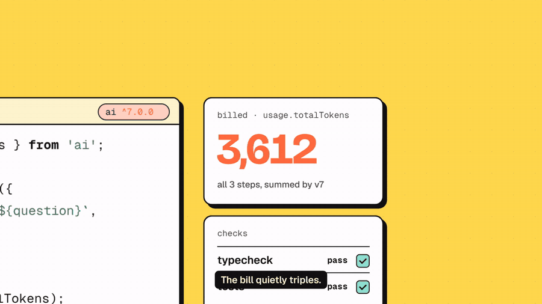

# Shim

[](https://www.npmjs.com/package/getshim) [](LICENSE)

Shim is an upgrade agent for TypeScript apps: when an API you depend on changes, it opens one tested pull request that updates your code before it breaks.

```sh
npx getshim scan .
```

Needs Node 22 or later. Site and live PR list: [getshim.dev](https://getshim.dev). Questions: hello@getshim.dev



The first migration is **Vercel AI SDK 6 -> 7**. The official codemod handles renames. Shim handles the changes that still compile but behave differently. For example, on a multi-step call `result.usage` now counts every step, and `result.response.messages` holds only the last step's messages.

## How it works

1. **Baseline.** Install with `--ignore-scripts`, then run the repo's type check and tests. Only gates that pass at baseline count.
2. **Upgrade.** Bump `ai` to ^7 and `@ai-sdk/*` to their latest majors, then run `npx @ai-sdk/codemod v7`.
3. **Find.** Scan the code with ts-morph (`src/rules/ai-sdk-v7.ts`). This finds calls imported from `ai`, follows their result variables and `onFinish`/`onEnd` events, and flags reads whose meaning changed.
4. **Fix.** Deterministic rewrites keep the v6 behavior, for example `result.usage` becomes `result.finalStep.usage`. With `--agent`, the remaining sites go to a headless Claude Code run with a narrow brief.
5. **Check.** Run the gates again. Any regression, or an unresolved breaking finding, produces an issue instead of a PR.
6. **Report.** Write `report.json` and `pr-body.md`.

## Usage

```sh
npx getshim scan path/to/repo
npx getshim migrate path/to/repo --agent --repo owner/name   # --agent needs the claude CLI
```

From a clone: `npm install`, then `npx tsx src/cli.ts scan path/to/repo`.

## What runs where

Shim runs on your machine or your CI. Nothing is sent to a Shim server.

- **`scan` and `fix` need no model and no API key.** They're static analysis and deterministic rewrites.
- **The fix agent (`migrate --agent`, `finish`) and the judge (`finish --judge`) need a model you provide.** By default Shim runs the `claude` CLI (Claude Code), which uses your own Claude login or `ANTHROPIC_API_KEY`, and you pay for what it uses. Before a run, Shim prints the backend, the auth source (never its value) and the models, and stops if the backend isn't installed.
- **Commands in the target repo never see your keys.** Installs use `--ignore-scripts`, and tests and builds run with API keys and tokens stripped from the environment (`src/exec.ts`).

| Variable | Purpose | Default |
|---|---|---|
| `SHIM_AGENT_BACKEND` | `claude-cli` or `dsh` (DeepSeek Harness, for open-source models) | `claude-cli` |
| `SHIM_FIXER_MODEL`, `SHIM_REVIEWER_MODEL`, `SHIM_JUDGE_MODEL` | Model id for each agent role (claude-cli only; dsh uses its own profile) | built-in Claude ids |
| `ANTHROPIC_API_KEY` | Pay per use instead of your Claude login | unset |
| `ANTHROPIC_BASE_URL` (+ `ANTHROPIC_AUTH_TOKEN`) | Any Anthropic-compatible provider. Cost is then recorded as `null` (unpriced) | unset |
| `SHIM_SANDBOX=1` | Required for `dsh`, which has no command allowlist: set it only in a throwaway container or VM with no credentials | unset |

`report.json` records the backend and models each run used, and `cost` in USD when it is priced.

## Rules (AI SDK 7)

| Rule | Severity | Fix |
|---|---|---|
| `multi-step-result`: `usage`, `toolCalls`, `content`, and similar reads on multi-step results | silent | auto (generateText), agent (streamText, destructuring) |
| `typed-multi-step-result`: the same reads on a parameter, variable, or property declared as `GenerateTextResult`, `StreamTextResult`, or `Awaited<ReturnType<typeof generateText>>`, where the producing call can't be seen | silent | agent |
| `multi-step-end-event`: the same reads on `onFinish`/`onEnd` events | silent | auto / agent |
| `response-messages`: `result.response.messages` now holds only the final step | silent | auto (generateText) / agent |
| `telemetry-needs-otel`: traces stop unless `@ai-sdk/otel` is registered | silent | manual |
| `system-in-messages`: `role: 'system'` in `messages`/`prompt` is rejected at runtime; Shim sets `allowSystemInMessages: true` on the call or `ToolLoopAgent` unless the messages are provably system-free | break | auto (agent when the options are built elsewhere) |
| `esm-only`: `require('ai')` throws | break | agent |
| `node-22`: `engines.node` below 22 | break | manual |
| `ci-node-version`: PR/push-triggered CI runs on Node below 22; rewrites the scalar/inline-matrix `node-version` to 22 (and a same-job matrix list it feeds), and flags a `node-version-file` below 22 | break | auto (node-version) / manual (node-version-file) |
| `total-usage`: `totalUsage` becomes `usage` | deprecated | auto |

## Tracking

`data/prs.csv` records every PR opened: state, merge time, and comments. The merge rate is the number that matters.
